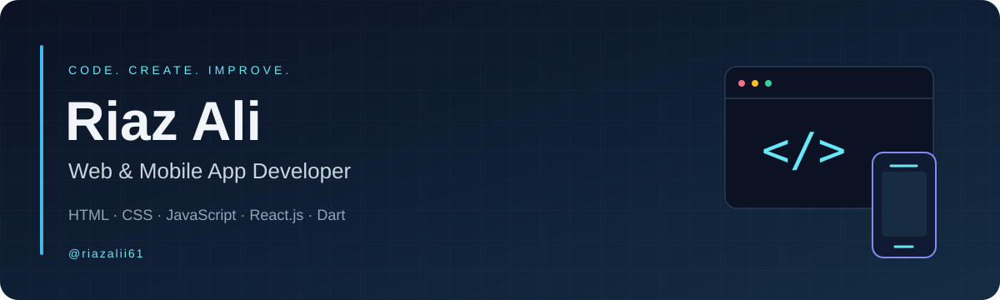

### Turning ideas into websites and mobile experiences.

**Responsive interfaces · Reusable components · Practical projects**

---

## About me

I'm **Riaz Ali**, a web and mobile app developer from **Pakistan**. I enjoy turning ideas into useful interfaces and learning through hands-on projects.

My web toolkit is **HTML, CSS, JavaScript and React.js**, and I work with **Dart** for mobile application development. My focus is on clear layouts, responsive design and easy-to-use experiences.

- **Web:** responsive pages and interactive interfaces.
- **React.js:** reusable components and organized UI.
- **Mobile:** application screens and user flows with Dart.
- **Mindset:** build, learn, refine and keep improving.

---

## Skills & technologies

### Web development

**HTML · CSS · JavaScript · React.js**

### Mobile application development

**Dart · Mobile App Development**

---

## What I build

| Focus | What I work on |
| :--- | :--- |
| **Responsive websites** | Layouts that adapt to mobile, tablet and desktop screens. |
| **Interactive interfaces** | Navigation, forms and useful interactions with JavaScript. |
| **React.js applications** | Component-based interfaces with reusable UI. |
| **Mobile applications** | App screens and connected user flows with Dart. |

---

## My development approach

**01 — Understand** the idea and the user's needs.  
**02 — Build** a clear interface with useful features.  
**03 — Refine** the layout, interactions and code.

---

## Let's connect

Have a web or mobile app idea, or want to discuss development?

**Email:** [riazalitechdev@gmail.com](mailto:riazalitechdev@gmail.com)  
**GitHub:** [@riazalii61](https://github.com/riazalii61)

 

